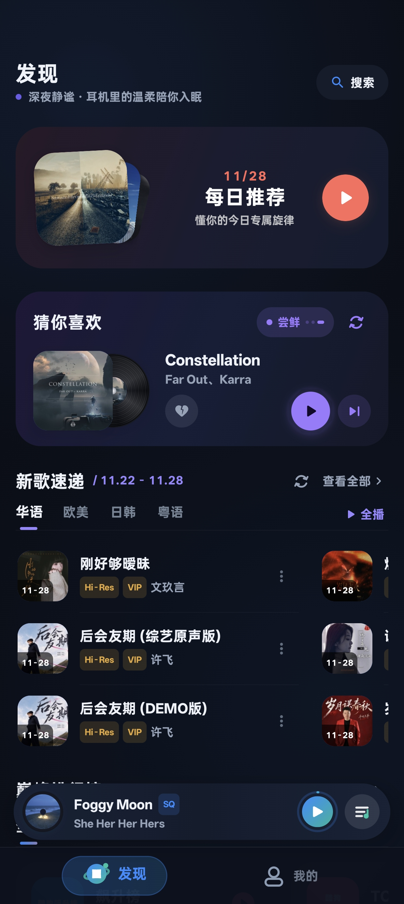
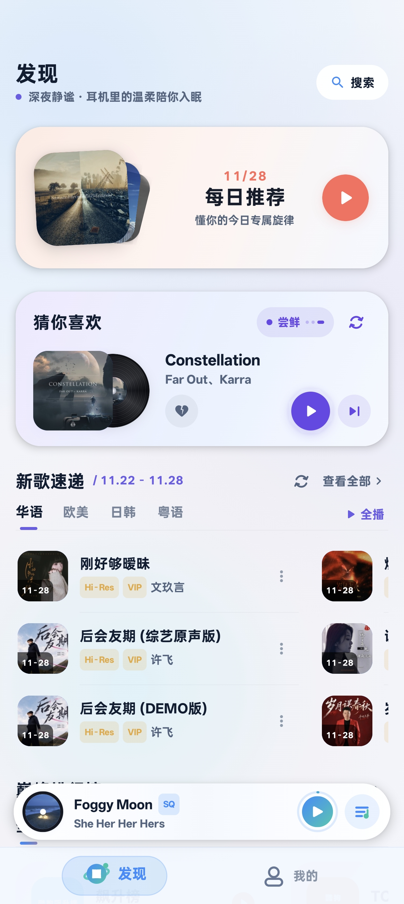
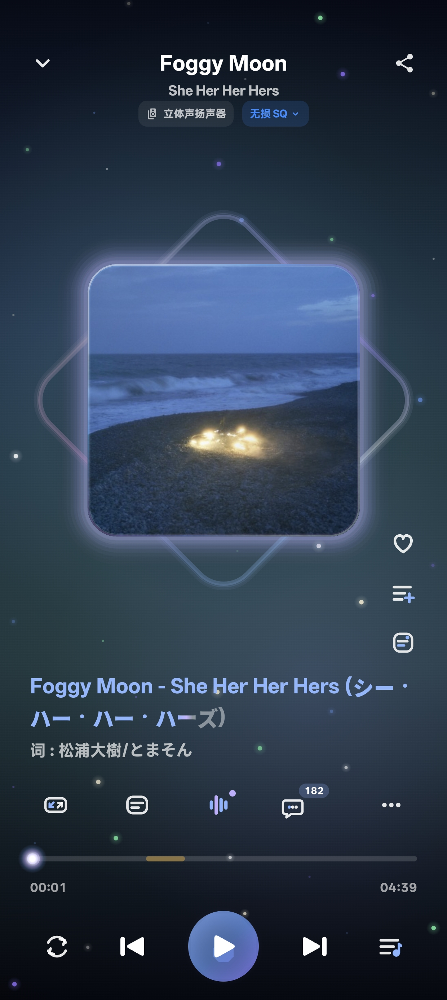
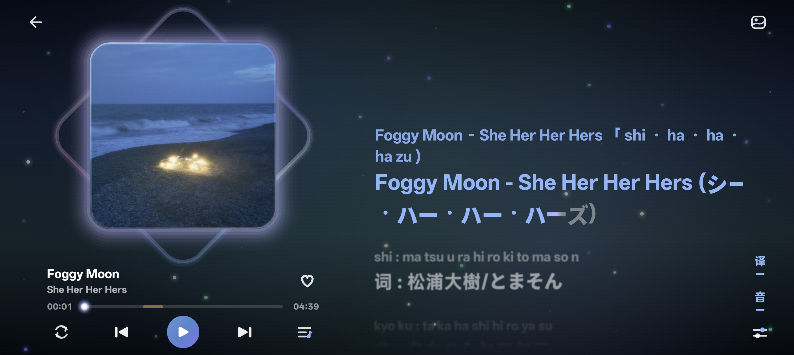

# BreezeMusic · 微风音乐 (Android)

<p align="center">
  <strong>耳畔微风起 · 帧享真无损</strong><br>
  一款基于 <strong>Kotlin + Jetpack Compose + AndroidX Media3</strong> 打造的轻量级 Android 高解析音乐客户端（支持手机、平板与车机独立三端）
</p>

<p align="center">
  
  
  
  
  
  
</p>

---

## 一、项目简介

**BreezeMusic Android（微风音乐安卓端）** 是一款采用 **Kotlin + Jetpack Compose (Material 3) + AndroidX Media3** 原生构建的轻量、纯粹、高解析 Android 音乐客户端，提供 **手机端 (`phone`)**、**平板与大屏端 (`tablet`)** 与 **独立车机端 (`car`)** 三构建变体（独立包名与独立签名，支持同设备共存零冲突）。

客户端将第三方概念版（`appid = 3116`、`clientver = 11440`）的协议通信、加解密签名与音源解析能力 **100% 纯 Kotlin 端侧直连化**，不依赖任何 Node.js / Python / Go 中转服务器；并在此基础上自研了 **64-bit 纯线性双二阶 (Pure LTI Biquad) 母带级 DSP 与车载座舱声学引擎、流光玻璃车机独立座舱与五大性能治理、四规格三风格原生微风桌面小组件（含 4×4 增量滚动歌词与全厂商一键添加适配）、五款高定动态播放背景、本地/云盘双页音乐中心与零云同步本地歌单、全局 120fps 欠阻尼弹性物理动效、KRC 逐字流光与跨应用穿透桌面歌词、Android 16 平板自适应布局及全链路安全加固架构**。

> [!NOTE]
> 桌面端同系列客户端请参阅姐妹仓库：[**BreezeMusic-Desktop (Windows)**](https://github.com/reneryi7/BreezeMusic-Desktop)。

---

## 二、界面预览

<p align="center">
  <table>
    <tr>
      <td align="center" width="33%"><b>发现页（深色模式）</b></td>
      <td align="center" width="33%"><b>发现页（浅色模式）</b></td>
      <td align="center" width="33%"><b>全屏沉浸播放页（竖屏）</b></td>
    </tr>
    <tr>
      <td align="center">
        
      </td>
      <td align="center">
        
      </td>
      <td align="center">
        
      </td>
    </tr>
    <tr>
      <td align="center" colspan="3"><b>横屏沉浸歌词播放页（双语译文 · 罗马音 · 逐字流光）</b></td>
    </tr>
    <tr>
      <td align="center" colspan="3">
        
      </td>
    </tr>
  </table>
</p>

---

## 三、核心特性与功能亮点

### 1. 纯端侧直连、曲库生态、本地/云盘中心与双端双向分享
* **零后端端侧直连与多元登录**：纯 Kotlin 实现概念版协议签名、RSA/AES 加解密与设备风控注册，直连官方网关并内置多通道容灾路由；支持手机短信验证码登录（自动识别同手机号下多账号切换）、官方二维码扫码登录与独立 OAuth 安全网关 **QQ 扫码直接登录**（零后端、零硬编码密钥、独立隔离防 SSRF）。
* **完整曲库生态、端云混合推荐与 7 天真实历史日推**：覆盖每日推荐（含今日在内完整 7 天真实历史探测与近 10 天本地快照留存、0px 位移固定锚点弹性日期菜单、今日日推端侧硬屏蔽与当前播放一键居中定位）、端云混合「猜你喜欢」（桌面同源黑胶封套舞台与物理换碟动效、极简三模式微点切换、官方语种/曲风/黑名单双向同步、45 天半衰期长期听歌画像与设置中心统一「推荐偏好」管理页）、新歌速递（华语 / 欧美 / 日韩 / 粤语四大精准语种 + 吸顶时间轴）、官方巅峰排行榜、随心听电台广场、实时热搜榜与主搜索多引擎歌词搜歌、歌手/专辑详情、微风服务级精准本机听歌排行（50%/4 分钟门槛、一播一会话防重与周/月/总榜领奖台）以及歌曲/歌单/专辑实时评论区。
* **「本地/云盘」双页音乐中心与零云同步本地歌单**：无边框「本地/云盘」双页中心支持未登录离线扫描、SAF 音乐目录与独立 `.lrc`/`.krc` 歌词目录导入；自研零重型依赖流式本地音频解析引擎（支持 FLAC / WAV / MP3 含 GB18030 防乱码 / M4A(ALAC/AAC) / OGG / Opus / APE / DSD 及物理音质层级、内嵌封面与歌词）；支持创建纯本地歌单或将本地音频挂载至现有云端自建歌单自动无损合并展示，严格维持 **100% 零云端上传隔离**；云盘支持无上限流式极速加载、本地缓存秒开与真实音质码率校准。
* **自建歌单进阶管理与封面自动同步**：支持云端编辑元信息、队列级平滑拖拽排序、长按批量多选、音频文件名扩展名自动清洗与 6 种排序模式；支持沉浸式 **1:1 拖动缩放封面裁剪上传**、一键恢复默认封面，以及未自定义封面时增删曲目自动同步最新标准歌曲封面至云端与本机。
* **多平台在线设备检测与酷狗双端双向分享**：账号管理页实时识别全平台在线登录设备并支持安全远程下线；支持标准版与概念版双向唤醒分享，内置 `KugouShareLinkParser` 零网络离线解码与外部歌单预览/一键批量导入。

### 2. 高解析音源、64-bit 母带 DSP 与手机端车载互联座舱声学
* **多音质智能解析与硬件级 `STREAMINFO` 探测**：自动解析 Hi-Res / SQ 无损 FLAC / HQ 高品 / 标准音质并平滑降级，遵循 [RFC 9639](https://www.rfc-editor.org/info/rfc9639) 轻量 `Range` 读取流头精准还原 `44.1 / 48.0 / 96.0 / 192.0 kHz` 采样率与 `16 / 24-bit` 位深；支持 Media3 `SimpleCache` 边听边存与四维分项缓存统计/清理。
* **64-bit 纯线性时不变 (`Pure LTI Biquad`) 母带级 DSP (`ConceptMasteringAudioProcessor`)**：
  * 全链路 64-bit 双精度 Direct Form I 滤波器网络（`THD = 0.000%`、`IMD = 0.000%`），配合 0 dB 平直频段短路加速与防重叠增益协同，彻底根除开启音效后的电流杂音与音量骤降。
  * **声场调音工作台与 10 段全参数均衡器 (PEQ)**：超重低音下潜、6 档低频分频谐振、3D 声场宽度与舞台纵深、Bauer 耳机交叉馈送、Schroeder 空间混响、人声通透与 6.2 kHz 齿音抑制；10 段独立增益（`-10 dB ~ +10 dB`、`0.1 dB` 步进）、5 种滤波器拓扑、`HPF / LPF`、一键 A/B 对比、5 大参考曲线与 `A / B / C` 自定义记忆槽。
* **手机端车载互联与 64-bit 座舱声学矩阵（手机版专属，平板变体静默隔离）**：
  * `PlaybackService` 升级为 AndroidX Media3 `MediaLibraryService`，内置 UID 校验车联媒体浏览树，兼容 **Android Auto / 华为 HiCar / 小米 CarWith / Carlink / CarLife**（含纯本地歌单浏览）。
  * 内置 **主驾皇帝位（左声道 `2.25ms` ITD 先导微延迟 + 右侧声压补偿 + 仪表台声像抬升 + 胎噪低频补偿）/ 全车均衡环绕 / 车载重低音炮 / 原车音响直通** 四大座舱声学模式，上下车原子快照自愈还原日常音效。
  * 配套智能导航平滑闪避（非对称闪避包络 + `1.85kHz` 谱闪避）、40ms 极速唤醒去鸣谢车载蓝牙 AVRCP 呼吸歌词（与手机本机通知栏双轨隔离，支持 `-5000ms ~ +5000ms` / 总上限 `±10000ms` 蓝牙与车载歌词延迟精确校准）、方向盘按键 `0ms` 零延迟直通、车机蓝牙白名单与默认关闭上车自动续播。
* **独立车机版（`BreezeMusic-car` · `com.concept.music.car`）**：
  * 专为安卓智能车机打造的流光玻璃座舱独立 UI，通过 `AppRootEntry` 源码集隔离实现 R8 摇树精简包体；自适应 **21:9 超宽带鱼屏 / 16:9 中控横屏 / 比亚迪 DiLink 旋转竖屏 / 1/3 导航分屏** 四大窗口形态。
  * 落地五大车机性能治理：冷启动极简瘦身、三档硬件算力与高温热降频自适应渲染（高配座舱 / 均衡流畅 / 极简省电）、车机调优 Coil 缓存与内存释放、默认 2GB 隧道/地库缓存（45s–180s 长缓冲 + 下一首预缓存）及 DSP 律动遥测按需门控；支持语音点歌、受控点火续播、酷狗/QQ 大屏双扫码、只读 U 盘无损直播与 4×2 车机专属桌面小组件。
* **进阶播放控制**：支持高潮副歌速刷（Climax 30s）、KTV 伴奏切换、跨曲无缝淡入淡出（Crossfade）、ReplayGain 响度均衡、0.5x–2.0x 倍速与升降调调节、三档音频焦点混音/闪避及有线耳机多击线控定制。

### 3. 五款高定动态播放背景、四规格微风桌面小组件、KRC 逐字歌词与 2K 海报
* **五款高定播放背景 × 播放/暂停连续动量 (`playMomentum`)**：内置 **封面虚化 (`400×400` 统一规格) / 三色无封面流体极光 / 实时三频音频律动光晕 / 暗夜星尘 / 深邃 OLED 纯黑**；三大动态背景采用连续相位积分器，播放与暂停切换时平滑减速驻留、零位置跳变。
* **四规格三风格原生微风桌面小组件与实时工作台**：零外部依赖基于原生 `RemoteViews` + 离屏 `Canvas` 打造 **4×2 经典黑胶卡 / 4×1 灵动胶囊条 / 2×2 精致方卡 / 4×4 杂志级沉浸唱片台** 与 **黑胶封套 / 流光封面 / 水彩叠层** 三大微风风格（WCAG AA 动态封面取色 + 随应用深浅切换）；4×4 唱片台支持 `ViewFlipper` + `partiallyUpdateAppWidget` 增量实时滚动歌词与精确到期后台调度；内置静态 WebP 预览消除插件面板卡顿，配套交互式「桌面小组件工作台」及覆盖 ColorOS / 澎湃OS / OriginOS / HarmonyOS / MagicOS / One UI / Flyme 的一键添加适配器。
* **端侧 KRC 逐字流光歌词与全局穿透桌面歌词**：内置 KRC XOR + Zlib 解密引擎，支持字内卡拉 OK 扫光、双语译文与日/韩罗马音、`O(1)` 前奏/间奏三点呼吸波点、光学景深模糊与 `2×3` 六大四字配色网格；系统级跨应用悬浮桌面歌词支持双行/三行自适应、封面取色随动、物理点击穿透锁定、熄屏零唤醒休眠及通知栏/流体云快捷开关。
* **2K 超清歌词海报与 1000P 高清封面预览**：支持多选歌词段落生成 2K PNG 海报并保存至相册，支持歌曲/专辑/歌单封面与歌手头像 1000P 原图预览导出。

### 4. 全局 120fps 弹性物理动效、低功耗守护与多端自适应架构
* **`ConceptMotion` 五维弹簧与无边框美学**：打造五维欠阻尼物理弹簧与 Android 12+ GPU `RenderEffect` 方向性运动虚化；设置中心与本地/云盘中心全面无边框化，单层 96 dp 极速启动页配双套深浅主题独立持久化。
* **手机、平板与车机三端独立自适应**：基于 `WindowSizeClass` 与 Android 16 大屏规范，平板横屏支持发现/我的双栏平铺、设置页 Master-Detail 左右分栏与合并式黑胶/歌词舞台；平板竖屏与分屏支持左侧垂直居中悬浮胶囊导航栏与 90° 全屏横屏画布翻转；车机独立版按屏幕宽高比自动在带鱼屏、标准横屏、旋转竖屏与导航分屏卡之间切换。
* **全链路低功耗与心流专注舱**：暂停态主线程 0 唤醒、后台自适应节流、熄屏停帧零耗电；内置心流专注舱（番茄钟 + 程序化环境白噪音混音）。

### 5. 全链路安全与本地隐私加固 (`v1.3.5 ~ v1.5.1`)
* **硬件级 AES-256-GCM 加密存储**：账号登录凭证与内部 256-bit IPC 能力令牌均基于 **AndroidKeyStore 256-bit AES-GCM**（随机 IV + AAD 绑定）加密持久化，遵循 **Fail-Closed**（密钥异常绝不明文落盘），支持老版本密文无感平滑迁移与多账号单条故障隔离；全面禁云备份与 Android 12+ 换机/USB 数据提取（`allowBackup="false"` + `data_extraction_rules.xml`）。
* **敏感窗口纵深防护**：登录页、车机大屏双扫码与安全验证弹窗（含独立 Dialog 窗口）接入引用计数式安全窗口守卫，统一启用 `FLAG_SECURE`（防截屏、防录屏与防后台缩略图泄露）、Android 12+ 隐藏悬浮窗与全版本 `filterTouchesWhenObscured` 防点击劫持；WebView 验证码弹窗使用 `WebViewAssetLoader` + `WebMessageListener` + 严格 CSP 沙箱隔离。
* **全链路网络安全与独立网关隔离**：核心登录、用户信息、更新与验证域名系统级强制 TLS，OkHttp 双拦截器阻断携带凭证的 HTTP 与跨域请求；QQ 扫码 OAuth 网关采用独立客户端与域名白名单物理隔离；API、Coil、ExoPlayer 自定义流源、下载器、封面裁剪与分享解析全链路接入公网 DNS 防重绑定 (`publicOnlyDns`)、逐跳重定向校验与图像解压炸弹防护；在线更新强制权威源或跨独立镜像双共识，下载链接强钉扎官方 Releases 路径并按手机/平板/车机变体精准匹配 APK。

---

## 四、技术栈总览

| 层级 | 核心技术与方案 |
| :--- | :--- |
| **开发语言与并发** | Kotlin 1.9+ · Kotlin Coroutines & StateFlow / SharedFlow · 前后台自适应节流 |
| **声明式 UI、小组件与动效** | Jetpack Compose (BOM 2024.06) · Material 3 · `WindowSizeClass` 平板与车机四形态自适应 · 原生 `RemoteViews` + 离屏 `Canvas` 四规格小组件 · `ConceptMotion` 五维弹簧 & `RenderEffect` 方向虚化 |
| **音频播放、DSP 与车联** | AndroidX Media3 (`ExoPlayer` · `MediaLibraryService` · `SimpleCache`) · 自研 64-bit Pure LTI Biquad 母带与座舱声学 DSP · UID 校验车联浏览树与语音点歌 |
| **网络、协议与图像** | OkHttp 4.12 · Retrofit 2.11 · Gson · 纯端侧 `KugouSigner` & 独立 `DirectQqQrAuthGateway` · Coil Compose 2.6 · 24-bin 三色特征提取 |
| **安全与本地音频引擎** | AndroidKeyStore (AES-256-GCM) · `SecurityGuards` 全链路纵深防护 · 自研零依赖流式 `LocalAudioMetadataParser` & `AudioMetadataEmbedder` |

---

## 五、下载安装与快速开始

### 方式一：普通用户直接安装（推荐）

前往本仓库右侧的 [**Releases**](https://github.com/reneryi7/BreezeMusic-Android/releases) 页面下载最新正式版 APK（支持 **Android 8.0 及以上，API 26–34**）：

| 安装包变体 | 文件名示例 | 包名与特性说明 |
| :--- | :--- | :--- |
| **手机版（推荐手机用户）** | `BreezeMusic-phone-v1.5.1.apk` | 包名 `com.concept.music`，竖屏交互优化、四规格桌面小组件与手机车载互联专属支持，可由历史手机版直接覆盖升级 |
| **平板版（推荐平板/大屏用户）** | `BreezeMusic-tablet-v1.5.1.apk` | 独立包名 `com.concept.music.tablet` 与独立签名，大屏双栏、四规格桌面小组件与自由旋转，可与手机/车机版共存 |
| **车机独立版（推荐安卓车机用户）** | `BreezeMusic-car-v1.5.1.apk` | 独立包名 `com.concept.music.car` 与独立签名，流光玻璃驾驶座舱、四形态屏幕自适应、五大性能治理与语音/点火续播，可与手机/平板版共存 |

> [!TIP]
> **安装与校验提示**
> 安装前可核对 Release 页面公布的 **SHA-256 校验值** 确认安装包完整未被篡改；如系统提示「未知来源应用」或安全提醒，确认校验值无误后允许安装即可。

### 方式二：开发者从源码克隆构建

#### 1. 环境准备
* **JDK 版本**：JDK 17（Android Studio 内置 JBR 17 即可）
* **Android SDK**：`minSdk = 26` (Android 8.0)，`compileSdk = 34` (Android 14)
* **Gradle**：项目内置 Gradle Wrapper (`./gradlew` / `gradlew.bat`)，无需手动安装

#### 2. 克隆源码并编译三端 APK（开箱即编译）

```bash
# 克隆仓库
git clone https://github.com/reneryi7/BreezeMusic-Android.git
cd BreezeMusic-Android

# 编译手机版、平板版与车机版 Debug 安装包
./gradlew :app:assemblePhoneDebug :app:assembleTabletDebug :app:assembleCarDebug

# 编译手机版、平板版与车机版 Release 安装包（启用 R8 代码优化与资源压缩）
./gradlew :app:assemblePhoneRelease :app:assembleTabletRelease :app:assembleCarRelease
```

编译完成后，三端 APK 产物路径分别为：
* 手机版：`app/build/outputs/apk/phone/release/app-phone-release.apk`
* 平板版：`app/build/outputs/apk/tablet/release/app-tablet-release.apk`
* 车机版：`app/build/outputs/apk/car/release/app-car-release.apk`

> [!NOTE]
> **关于签名配置与无密钥开箱编译**
> 为保障发布安全，仓库不包含正式签名密钥（`app/keystore/*.jks` 与 `keystore.properties` 已被 `.gitignore` 严格排除）。**外部开发者克隆后无需任何额外配置即可直接运行上述构建命令**，脚本在未检测到外部正式签名凭据时会自动回退至本机默认 `debug` 签名生成可直接安装的 APK。
> 如需使用自定义正式证书签名发布，可在根目录创建 `keystore.properties`（或通过环境变量 `PHONE_KEYSTORE_PATH` / `TABLET_KEYSTORE_PATH` / `CAR_KEYSTORE_PATH` 等）注入证书路径与口令，并可在发布/CI 中设置 `REQUIRE_RELEASE_SIGNING=true` 强制校验正式签名。

#### 3. 运行全变体单元测试套件

```bash
# macOS / Linux
./gradlew :app:testPhoneDebugUnitTest :app:testTabletDebugUnitTest :app:testCarDebugUnitTest

# Windows PowerShell / CMD
.\gradlew.bat :app:testPhoneDebugUnitTest :app:testTabletDebugUnitTest :app:testCarDebugUnitTest
```

---

## 六、项目目录结构

```text
BreezeMusic-Android/
├── .github/
│   └── ISSUE_TEMPLATE/                              # Bug 反馈与功能建议表单模板（支持手机/平板/车机三变体）
├── docs/
│   └── screenshots/                                 # README 应用实机界面预览截图
│       ├── discover-dark.jpg                        # 发现页（深色模式）
│       ├── discover-light.jpg                       # 发现页（浅色模式）
│       ├── player-portrait.jpg                      # 全屏沉浸播放页（竖屏）
│       └── player-landscape.jpg                     # 横屏沉浸歌词播放页
├── app/
│   ├── build.gradle.kts                             # 模块级 Gradle 构建配置 (v1.5.1, phone/tablet/car 三变体独立签名与安全回退)
│   ├── proguard-rules.pro                           # Release 混淆、R8 精简、Gson 模型保留与日志剥离规则
│   └── src/
│       ├── phone/                                   # 手机变体专属 Manifest (ACTION_SEND) 与 AppRootEntry 入口
│       ├── tablet/                                  # 平板变体专属 Manifest (ACTION_SEND) 与 AppRootEntry 入口
│       ├── car/                                     # 车机独立变体专属源码与资源（流光玻璃座舱 UI、点火续播接收器与 4×2 车机小组件）
│       ├── main/
│       │   ├── AndroidManifest.xml                  # 应用组件、MediaLibraryService、车联声明、四规格桌面小组件、禁备份与权限声明
│       │   ├── assets/verification/                 # 本地安全验证 WASM 与严格 CSP 隔离页面
│       │   ├── java/com/concept/music/
│       │   │   ├── ConceptMusicApp.kt               # Application 入口、车机冷启动瘦身与安全 Coil 图像管线
│       │   │   ├── MainActivity.kt                  # 宿主 Activity：单层 96dp 启动页、singleTask 返回栈协同与高刷申请
│       │   │   ├── data/
│       │   │   │   ├── kugou/                       # 酷狗概念版 (appid=3116) 纯端侧协议层、独立 QQ 扫码 OAuth 网关、AES-256 会话存储与安全传输网关
│       │   │   │   ├── model/                       # 领域数据模型 (Song / LocalMusic / Lyric / Playlist / Comment / Discover / Library / Search)
│       │   │   │   ├── recommendation/              # 端云混合个性化推荐引擎、长期听歌画像、官方偏好双向同步与曲目元数据缓存
│       │   │   │   ├── repository/                  # 本地音乐扫描、纯本地歌单零云同步、封面覆盖、播放历史、本机听歌统计与 SWR/云盘缓存仓库
│       │   │   │   ├── share/                       # 酷狗双端双向分享与零网络离线链接解析器
│       │   │   │   └── vip/                         # 全局仓库门面 (VipManager) 与听歌等级管理
│       │   │   ├── service/                         # Media3 MediaLibraryService、64-bit 母带与座舱声学 DSP、车载会话/浏览树/语音点歌、本地音频解析、桌面歌词、心流舱与权限中心
│       │   │   ├── ui/                              # Jetpack Compose 声明式界面（account / comment / components / home / library / navigation / search / settings / theme / viewmodel）
│       │   │   ├── widget/                          # 四规格三风格微风桌面小组件（渲染引擎、离屏封面管线、增量滚词调度与全厂商一键添加适配器）
│       │   │   └── util/
│       │   │       └── SecurityGuards.kt            # 全链路安全守卫（反 SSRF、更新钉扎、路径防穿越、图像炸弹防护、加密 IPC 令牌与敏感窗口守卫）
│       │   └── res/                                 # Android 资源、小组件布局/WebP 预览、automotive_app_desc、network_security_config、data_extraction_rules 与双套启动页图标
│       ├── test/java/com/concept/music/             # JVM 单元测试套件（CarStandaloneFlavorTest / BreezeWidgetTest / CarInterconnectTest / LocalPlaylistIsolationTest / SecurityHardeningTest / UiAlignmentRegressionTest 等）
│       └── androidTest/java/com/concept/music/      # 仪器化测试（加密存储与 WebView WASM 验证）
├── gradle/wrapper/                                  # Gradle 8.7 Wrapper
├── build.gradle.kts                                 # 根项目构建脚本
├── settings.gradle.kts                              # 仓库与模块配置
├── CHANGELOG.md                                     # 版本更新日志 (Keep a Changelog)
├── THIRD_PARTY_NOTICES.md                           # 第三方开源组件与上游协议致谢声明
└── LICENSE                                          # GNU General Public License v3.0
```

---

## 七、使用小贴士

* **关于音乐下载与歌词保存模块**：为保持界面默认纯净合规，下载功能默认处于关闭与隐藏状态（设置页与歌曲菜单均不显示下载入口）。如个人本地学习测试确需使用，可前往 **「设置 → 权限管理」** 手动开启 **「音乐下载与歌词保存」** 开关，解锁后可在 **「设置 → 下载」** 中通过系统目录选择器自定义音频与 `.lrc` 歌词保存路径（默认自动内嵌 1000P 高清封面、歌曲标签与时间轴歌词，并可按需开启同步生成独立 `.lrc` 文件），亦可从「我的」页顶栏快捷查看下载队列。
* **版本更新记录**：所有历史版本的完整变更明细均同步维护在 [CHANGELOG.md](CHANGELOG.md) 中，并与应用内 **「设置 → 关于 → 版本更新日志」** 及 [GitHub Releases](https://github.com/reneryi7/BreezeMusic-Android/releases) 保持一致。

---

## 八、免责与版权声明

1. **非商业学习性质**：本项目（**BreezeMusic Android / 微风音乐安卓端**）系完全开源、非营利性质的个人计算机软件工程与移动开发技术探索项目，旨在实践 Kotlin 协程并发、Jetpack Compose 声明式 UI、AndroidX Media3 实时音频数字信号处理（DSP）、端侧安全加固及平板自适应架构设计。本项目仅供个人学习、技术交流与编程研究使用，严禁用于任何商业牟利、付费售卖或违规分发。
2. **音乐版权归属**：本应用与任何商业音乐平台及原厂均无从属或官方关联，自身不存储、不托管、不分发任何受版权保护的音频、歌词或封面文件。应用内展示及播放内容均由用户端直连公开网络接口获取，其著作权与邻接权均归原版权方及唱片公司所有。请支持正版音乐，自觉遵守当地法律法规与相关服务条款；任何个人学习测试产生的本地文件请于 24 小时内自行删除。

---

## 九、开源致谢

* [MakcRe/KuGouMusicApi](https://github.com/MakcRe/KuGouMusicApi)：提供了详实的酷狗音乐与酷狗概念版协议研究基础（MIT License）。
* [lisalee23042605/kgmusicbot](https://github.com/lisalee23042605/kgmusicbot)：提供了多音质下载与音频封面/歌词标签内嵌的实现参考。
* [AndroidX Media3](https://developer.android.com/media/media3)、[Jetpack Compose](https://developer.android.com/jetpack/compose)、[OkHttp](https://square.github.io/okhttp/) & [Coil](https://coil-kt.github.io/coil/)：提供了现代化的 Android 媒体播放、声明式 UI、网络与图像管线生态支持。
* 更多上游开源依赖与协议说明请参见 [THIRD_PARTY_NOTICES.md](THIRD_PARTY_NOTICES.md)。

---

## 十、开源许可证 (License)

本项目基于 **[GNU General Public License v3.0 (GPL-3.0)](LICENSE)** 协议开源，与桌面端 [BreezeMusic-Desktop](https://github.com/reneryi7/BreezeMusic-Desktop) 保持完全一致。任何人均可自由学习、修改与分享，但任何基于本项目的衍生作品或二次分发版本均须保持相同的 GPL-3.0 开源协议，且不得闭源用于商业牟利。
